# Resultados — Camanchaca-Predict

Documento GENERADO por `camanchaca report` a partir de `reports/tables/` y `reports/figures/` (no editar a mano: se sobrescribe). Protocolo: ResNet-50 vs DeiT-S con el mismo preprocesamiento, cabeza, pérdida, presupuesto y selección en val; media ± sd entre semillas e IC bootstrap agrupado por escena/secuencia.

> Nota: si las tablas se generaron con `camanchaca smoke` (datos sintéticos), sus números NO son resultados.

## Datos

Número de imágenes por split × fuente × banda (salida de `camanchaca split`).

Generado por `camanchaca split`. Celdas: n imágenes (n grupos). Banda según la V MOR (eps = 5 %); 'Sin etiqueta' = O-HAZE, fotos propias e imágenes limpias.

| Conjunto | Fuente | Crítico (<50 m) | Alto riesgo (50–100 m) | Precaución (100–200 m) | Aceptable (≥200 m) | Sin etiqueta | Total imágenes | Total grupos |
|---|---|---:|---:|---:|---:|---:|---:|---:|
| train | cs_fog | 1478 (818) | 852 (520) | 845 (499) | 1857 (960) | 0 | 5032 | 1621 |
| train | foggy_cs | 0 | 0 | 4041 (2672) | 8082 (2672) | 0 | 12123 | 2672 |
| train | reside_ots | 8646 (1441) | 1441 (1441) | 0 | 0 | 0 | 10087 | 1441 |
| val | cs_fog | 256 (130) | 166 (76) | 151 (81) | 345 (163) | 0 | 918 | 264 |
| val | foggy_cs | 0 | 0 | 459 (264) | 918 (264) | 0 | 1377 | 264 |
| val | reside_ots | 1860 (310) | 310 (310) | 0 | 0 | 0 | 2170 | 310 |
| test | cs_fog | 267 (101) | 155 (63) | 177 (71) | 401 (170) | 0 | 1000 | 235 |
| test | foggy_cs | 0 | 0 | 500 (235) | 1000 (235) | 0 | 1500 | 235 |
| test | reside_ots | 1860 (310) | 310 (310) | 0 | 0 | 0 | 2170 | 310 |
| ext | hazerd | 15 (15) | 15 (15) | 15 (15) | 30 (15) | 0 | 75 | 15 |
| ext | ohaze | 0 | 0 | 0 | 0 | 90 (45) | 90 | 45 |
| **total** |  |  |  |  |  |  | 36542 | 5292 |

Fuente: [`tables/data_counts.md`](tables/data_counts.md)

## Barrido de tasa de aprendizaje

Misma grilla y presupuesto para ambas arquitecturas; LR elegido solo en val.

Misma grilla y mismo presupuesto para todos los modelos (semilla 0, 1200 pasos). Criterio: `val_log10_mae_macro_source` en val (menor es mejor; empate -> menor LR).

| Modelo | LR backbone | LR cabeza | Mejor valor | Paso | Pasos | Elegido |
|---|---|---|---|---|---|---|
| resnet50 | 3e-05 | 0.0003 | 0.1221 | 900 | 1200 |  |
| resnet50 | 0.0001 | 0.001 | 0.0893 | 900 | 1200 |  |
| resnet50 | 0.0003 | 0.003 | 0.0726 | 1200 | 1200 | **sí** |
| deit_s | 3e-05 | 0.0003 | 0.0566 | 1200 | 1200 |  |
| deit_s | 0.0001 | 0.001 | 0.0522 | 1200 | 1200 | **sí** |
| deit_s | 0.0003 | 0.003 | 0.0523 | 1200 | 1200 |  |

Fuente: [`tables/lr_sweep.md`](tables/lr_sweep.md)

## Métricas en validación

Conjunto usado para seleccionar modelos e hiperparámetros (no es una estimación insesgada del desempeño).

Celdas: media ± desviación estándar entre semillas; entre corchetes, IC 95 % bootstrap agrupado por `group` (percentil, B = 2000) del modelo promediado entre semillas. Solo filas con etiqueta; los baselines tienen una sola corrida. log10-MAE en décadas: 0,1 década ≈ error multiplicativo ×1,26; 0,3 décadas ≈ ×2.

### Global

| Modelo | Tipo | Semillas | n (imágenes) | Grupos | log10-MAE (décadas) | Error multiplicativo (×) | MdAPE (%) | δ<1,25 (fracción) | Spearman ρ | Macro-F1 bandas desde V̂ | Macro-F1 bandas CORN | Tasa falso-seguro (fracción) | AUC-PR V<100 m | MAE (m) | n peligrosos (V<100 m) |
|---|---|---|---|---|---|---|---|---|---|---|---|---|---|---|---|
| **resnet50** | modelo | 3 | 4465 | 574 | 0.0656 ± 0.00137 [0.0618, 0.0709] | 1.16 ± 0.00367 | 11.3 ± 0.16 [10.7, 12.4] | 0.768 ± 0.00696 [0.739, 0.789] | 0.98 ± 0.000566 [0.967, 0.984] | 0.898 ± 0.00343 [0.885, 0.908] | 0.912 ± 0.00365 | 0.00694 ± 0.000772 [0.00394, 0.00996] | 1 ± 5.10e-05 | 25.3 ± 0.482 | 2592 |
| **deit_s** | modelo | 3 | 4465 | 574 | 0.0498 ± 0.000687 [0.0445, 0.0563] | 1.12 ± 0.00177 | 7.26 ± 0.178 [6.04, 8.88] | 0.842 ± 0.0028 [0.809, 0.867] | 0.984 ± 0.000266 [0.974, 0.987] | 0.912 ± 0.00223 [0.902, 0.921] | 0.924 ± 0.000682 | 0.00502 ± 0.00204 [0.00253, 0.00746] | 1 ± 1.34e-05 | 16.6 ± 0.425 | 2592 |
| **majority_band** | baseline | 1 | 4465 | 574 | 0.556 [0.438, 0.669] | 3.6 | 67.3 [47.7, 81.9] | 0.16 [0.12, 0.202] | — | 0.161 [0.13, 0.187] | — | 0 [0, 0] | 0.581 | 149 | 2592 |
| **mean_by_source** | baseline | 1 | 4465 | 574 | 0.246 [0.229, 0.263] | 1.76 | 50 [50, 50] | 0.263 [0.255, 0.273] | 0.784 [0.726, 0.788] | 0.44 [0.428, 0.452] | — | 0.163 [0.0874, 0.279] | 0.974 | 90.2 | 2592 |
| **mean_global** | baseline | 1 | 4465 | 574 | 0.492 [0.473, 0.512] | 3.1 | 84.4 [81.7, 159] | 0.0206 [0.0117, 0.028] | — | 0.0601 [0.0418, 0.076] | — | 1 [1, 1] | 0.581 | 147 | 2592 |
| **physics_hgb** | baseline | 1 | 4465 | 574 | 0.137 [0.129, 0.148] | 1.37 | 21.3 [20.1, 22.8] | 0.511 [0.49, 0.53] | 0.914 [0.866, 0.933] | 0.727 [0.696, 0.746] | — | 0.0529 [0.0366, 0.0704] | 0.987 | 48.2 | 2592 |
| **physics_ridge** | baseline | 1 | 4465 | 574 | 0.222 [0.211, 0.238] | 1.67 | 39.7 [37.5, 43.4] | 0.281 [0.263, 0.3] | 0.835 [0.762, 0.877] | 0.565 [0.546, 0.586] | — | 0.117 [0.0916, 0.145] | 0.963 | 71 | 2592 |

### Por fuente

| Fuente | Modelo | n (imágenes) | Grupos | log10-MAE (décadas) | MdAPE (%) | δ<1,25 (fracción) | Spearman ρ | Macro-F1 bandas desde V̂ | Tasa falso-seguro (fracción) |
|---|---|---|---|---|---|---|---|---|---|
| cs_fog | resnet50 | 918 | 264 | 0.0539 ± 0.000698 [0.0488, 0.0563] | 9.49 ± 0.307 [8.66, 9.95] | 0.848 ± 0.00874 [0.831, 0.887] | 0.991 ± 0.000341 [0.987, 0.992] | 0.904 ± 0.00822 [0.89, 0.934] | 0.019 ± 0.00237 [0.00797, 0.029] |
| cs_fog | deit_s | 918 | 264 | 0.0508 ± 0.00134 [0.0463, 0.0531] | 9.34 ± 0.401 [8.5, 9.99] | 0.863 ± 0.00274 [0.846, 0.898] | 0.993 ± 0.000201 [0.989, 0.994] | 0.91 ± 0.00282 [0.897, 0.938] | 0.0182 ± 0.00274 [0.00823, 0.0297] |
| cs_fog | majority_band | 918 | 264 | 0.685 [0.654, 0.72] | 77.1 [74.3, 80.6] | 0.105 [0.0871, 0.131] | — | 0.109 [0.102, 0.122] | 0 [0, 0] |
| cs_fog | mean_by_source | 918 | 264 | 0.451 [0.437, 0.482] | 77.3 [75.7, 81] | 0.106 [0.0852, 0.127] | — | 0.0706 [0.0607, 0.0789] | 1 [1, 1] |
| cs_fog | mean_global | 918 | 264 | 0.451 [0.437, 0.483] | 77.6 [74.7, 81.3] | 0.1 [0.0758, 0.119] | — | 0.0706 [0.0607, 0.0789] | 1 [1, 1] |
| cs_fog | physics_hgb | 918 | 264 | 0.114 [0.1, 0.12] | 18.5 [16.4, 20.2] | 0.563 [0.536, 0.625] | 0.959 [0.953, 0.966] | 0.734 [0.691, 0.761] | 0.0308 [0.0153, 0.0705] |
| cs_fog | physics_ridge | 918 | 264 | 0.158 [0.146, 0.164] | 28.3 [25.2, 30.8] | 0.397 [0.367, 0.438] | 0.937 [0.924, 0.943] | 0.683 [0.644, 0.712] | 0.0379 [0.0227, 0.0741] |
| foggy_cs | resnet50 | 1377 | 264 | 0.0568 ± 0.00168 [0.0537, 0.0618] | 9.29 ± 0.105 [8.69, 9.95] | 0.817 ± 0.012 [0.798, 0.841] | 0.93 ± 0.000934 [0.912, 0.937] | 0.979 ± 0.000754 [0.966, 0.984] | — |
| foggy_cs | deit_s | 1377 | 264 | 0.0239 ± 0.00159 [0.021, 0.0279] | 2.32 ± 0.169 [2.21, 2.56] | 0.949 ± 0.00727 [0.938, 0.963] | 0.935 ± 0.001 [0.921, 0.941] | 0.99 ± 0.00189 [0.983, 0.994] | — |
| foggy_cs | majority_band | 1377 | 264 | 1.04 [1.04, 1.04] | 91 [91, 91] | 0 [0, 0] | — | 0 [0, 0] | — |
| foggy_cs | mean_by_source | 1377 | 264 | 0.201 [0.201, 0.201] | 50 [50, 50] | 0.333 [0.333, 0.333] | — | 0.4 [0.4, 0.4] | — |
| foggy_cs | mean_global | 1377 | 264 | 0.438 [0.438, 0.438] | 63.5 [63.5, 63.5] | 0 [0, 0] | — | 0.25 [0.25, 0.25] | — |
| foggy_cs | physics_hgb | 1377 | 264 | 0.12 [0.102, 0.129] | 18.3 [15.9, 19.5] | 0.548 [0.524, 0.601] | 0.813 [0.801, 0.849] | 0.825 [0.805, 0.849] | — |
| foggy_cs | physics_ridge | 1377 | 264 | 0.197 [0.164, 0.214] | 36 [31, 38.1] | 0.283 [0.241, 0.37] | 0.787 [0.747, 0.817] | 0.658 [0.612, 0.747] | — |
| reside_ots | resnet50 | 2170 | 310 | 0.0762 ± 0.00152 [0.0714, 0.0812] | 13.9 ± 0.38 [12.9, 14.9] | 0.703 ± 0.00519 [0.675, 0.733] | 0.91 ± 0.00357 [0.898, 0.921] | 0.816 ± 0.00597 [0.798, 0.832] | 0.00461 ± 0.00122 [0.00246, 0.00707] |
| reside_ots | deit_s | 2170 | 310 | 0.0659 ± 0.000533 [0.0617, 0.0704] | 11.7 ± 0.0573 [10.8, 12.7] | 0.765 ± 0.00227 [0.735, 0.793] | 0.931 ± 0.00152 [0.922, 0.939] | 0.834 ± 0.00466 [0.82, 0.85] | 0.00246 ± 0.00192 [0.00108, 0.00415] |
| reside_ots | majority_band | 2170 | 310 | 0.192 [0.192, 0.192] | 44.6 [44.6, 44.6] | 0.286 [0.286, 0.286] | — | 0.462 [0.462, 0.462] | 0 [0, 0] |
| reside_ots | mean_by_source | 2170 | 310 | 0.189 [0.189, 0.189] | 37.3 [37.3, 37.3] | 0.286 [0.286, 0.286] | — | 0.462 [0.462, 0.462] | 0 [0, 0] |
| reside_ots | mean_global | 2170 | 310 | 0.543 [0.543, 0.543] | 265 [265, 265] | 0 [0, 0] | — | 0 [0, 0] | 1 [1, 1] |
| reside_ots | physics_hgb | 2170 | 310 | 0.158 [0.143, 0.175] | 24.5 [22.5, 26.6] | 0.465 [0.435, 0.495] | 0.667 [0.63, 0.705] | 0.676 [0.648, 0.702] | 0.0571 [0.0387, 0.077] |
| reside_ots | physics_ridge | 2170 | 310 | 0.265 [0.247, 0.286] | 53.9 [49, 63] | 0.231 [0.206, 0.256] | 0.448 [0.416, 0.484] | 0.502 [0.476, 0.527] | 0.132 [0.105, 0.161] |

### Por calidad de etiqueta

| Calidad de etiqueta | Modelo | n (imágenes) | Grupos | log10-MAE (décadas) | MdAPE (%) | δ<1,25 (fracción) | Spearman ρ | Macro-F1 bandas desde V̂ | Tasa falso-seguro (fracción) |
|---|---|---|---|---|---|---|---|---|---|
| equivalente | resnet50 | 2170 | 310 | 0.0762 ± 0.00152 [0.0714, 0.081] | 13.9 ± 0.38 [12.9, 14.9] | 0.703 ± 0.00519 [0.674, 0.732] | 0.91 ± 0.00357 [0.898, 0.922] | 0.816 ± 0.00597 [0.798, 0.832] | 0.00461 ± 0.00122 [0.0023, 0.00722] |
| equivalente | deit_s | 2170 | 310 | 0.0659 ± 0.000533 [0.0615, 0.0702] | 11.7 ± 0.0573 [10.8, 12.7] | 0.765 ± 0.00227 [0.737, 0.793] | 0.931 ± 0.00152 [0.922, 0.94] | 0.834 ± 0.00466 [0.82, 0.851] | 0.00246 ± 0.00192 [0.00108, 0.00415] |
| equivalente | majority_band | 2170 | 310 | 0.192 [0.192, 0.192] | 44.6 [44.6, 44.6] | 0.286 [0.286, 0.286] | — | 0.462 [0.462, 0.462] | 0 [0, 0] |
| equivalente | mean_by_source | 2170 | 310 | 0.189 [0.189, 0.189] | 37.3 [37.3, 37.3] | 0.286 [0.286, 0.286] | — | 0.462 [0.462, 0.462] | 0 [0, 0] |
| equivalente | mean_global | 2170 | 310 | 0.543 [0.543, 0.543] | 265 [265, 265] | 0 [0, 0] | — | 0 [0, 0] | 1 [1, 1] |
| equivalente | physics_hgb | 2170 | 310 | 0.158 [0.143, 0.175] | 24.5 [22.4, 26.5] | 0.465 [0.437, 0.496] | 0.667 [0.63, 0.705] | 0.676 [0.649, 0.703] | 0.0571 [0.0382, 0.0774] |
| equivalente | physics_ridge | 2170 | 310 | 0.265 [0.247, 0.284] | 53.9 [48.8, 62.4] | 0.231 [0.206, 0.258] | 0.448 [0.416, 0.484] | 0.502 [0.477, 0.529] | 0.132 [0.105, 0.16] |
| metrica | resnet50 | 2295 | 264 | 0.0557 ± 0.00128 [0.0522, 0.0586] | 9.37 ± 0.204 [8.83, 9.85] | 0.829 ± 0.00972 [0.816, 0.857] | 0.965 ± 0.00078 [0.956, 0.969] | 0.936 ± 0.00636 [0.925, 0.949] | 0.019 ± 0.00237 [0.00744, 0.0286] |
| metrica | deit_s | 2295 | 264 | 0.0347 ± 0.000841 [0.0317, 0.0369] | 4.08 ± 0.241 [3.75, 4.37] | 0.915 ± 0.00387 [0.905, 0.934] | 0.969 ± 5.80e-05 [0.964, 0.973] | 0.942 ± 0.00423 [0.93, 0.956] | 0.0182 ± 0.00274 [0.00926, 0.0304] |
| metrica | majority_band | 2295 | 264 | 0.9 [0.889, 0.913] | 91 [90.8, 91] | 0.0418 [0.0344, 0.0523] | — | 0.0502 [0.0464, 0.057] | 0 [0, 0] |
| metrica | mean_by_source | 2295 | 264 | 0.301 [0.295, 0.312] | 50 [50, 52.8] | 0.242 [0.235, 0.251] | 0.38 [0.335, 0.42] | 0.223 [0.215, 0.23] | 1 [1, 1] |
| metrica | mean_global | 2295 | 264 | 0.443 [0.437, 0.455] | 63.5 [63.5, 63.5] | 0.0401 [0.0311, 0.0477] | — | 0.105 [0.102, 0.108] | 1 [1, 1] |
| metrica | physics_hgb | 2295 | 264 | 0.118 [0.103, 0.124] | 18.3 [16.5, 19.5] | 0.554 [0.534, 0.601] | 0.895 [0.888, 0.916] | 0.759 [0.722, 0.777] | 0.0308 [0.0157, 0.072] |
| metrica | physics_ridge | 2295 | 264 | 0.181 [0.158, 0.192] | 32.9 [28.8, 34.3] | 0.329 [0.301, 0.39] | 0.871 [0.847, 0.887] | 0.612 [0.589, 0.665] | 0.0379 [0.0227, 0.0773] |

Fuente: [`tables/metrics_val.md`](tables/metrics_val.md)

## Métricas en test (evaluación final)

Conjunto bloqueado: se evaluó una sola vez con `--final`.

Celdas: media ± desviación estándar entre semillas; entre corchetes, IC 95 % bootstrap agrupado por `group` (percentil, B = 2000) del modelo promediado entre semillas. Solo filas con etiqueta; los baselines tienen una sola corrida. log10-MAE en décadas: 0,1 década ≈ error multiplicativo ×1,26; 0,3 décadas ≈ ×2.

### Global

| Modelo | Tipo | Semillas | n (imágenes) | Grupos | log10-MAE (décadas) | Error multiplicativo (×) | MdAPE (%) | δ<1,25 (fracción) | Spearman ρ | Macro-F1 bandas desde V̂ | Macro-F1 bandas CORN | Tasa falso-seguro (fracción) | AUC-PR V<100 m | MAE (m) | n peligrosos (V<100 m) |
|---|---|---|---|---|---|---|---|---|---|---|---|---|---|---|---|
| **resnet50** | modelo | 3 | 4670 | 545 | 0.0619 ± 0.000846 [0.0586, 0.0669] | 1.15 ± 0.00225 | 10.9 ± 0.0998 [10.3, 11.9] | 0.793 ± 0.0065 [0.76, 0.815] | 0.982 ± 0.000455 [0.969, 0.985] | 0.895 ± 0.0019 [0.887, 0.903] | 0.911 ± 0.00301 | 0.00862 ± 0.00135 [0.00493, 0.0124] | 1 ± 5.80e-05 | 24.1 ± 0.662 | 2592 |
| **deit_s** | modelo | 3 | 4670 | 545 | 0.0456 ± 0.000705 [0.0401, 0.0535] | 1.11 ± 0.0018 | 6.51 ± 0.22 [5.29, 8.33] | 0.866 ± 0.00317 [0.826, 0.894] | 0.986 ± 0.000161 [0.975, 0.988] | 0.915 ± 0.00274 [0.905, 0.923] | 0.929 ± 0.00199 | 0.00604 ± 0.000589 [0.00252, 0.00992] | 1 ± 5.51e-05 | 15 ± 0.584 | 2592 |
| **majority_band** | baseline | 1 | 4670 | 545 | 0.578 [0.436, 0.693] | 3.78 | 78.7 [45.8, 81.9] | 0.159 [0.121, 0.206] | — | 0.156 [0.125, 0.189] | — | 0 [0, 0] | 0.555 | 159 | 2592 |
| **mean_by_source** | baseline | 1 | 4670 | 545 | 0.251 [0.228, 0.269] | 1.78 | 50 [50, 50] | 0.263 [0.256, 0.273] | 0.782 [0.722, 0.786] | 0.442 [0.431, 0.449] | — | 0.163 [0.0707, 0.29] | 0.97 | 96.8 | 2592 |
| **mean_global** | baseline | 1 | 4670 | 545 | 0.492 [0.475, 0.514] | 3.11 | 81.7 [81.7, 192] | 0.0223 [0.0127, 0.0295] | — | 0.0633 [0.04, 0.0808] | — | 1 [1, 1] | 0.555 | 153 | 2592 |
| **physics_hgb** | baseline | 1 | 4670 | 545 | 0.137 [0.127, 0.144] | 1.37 | 21.3 [20.2, 22.4] | 0.51 [0.492, 0.534] | 0.921 [0.876, 0.933] | 0.736 [0.72, 0.759] | — | 0.039 [0.0248, 0.055] | 0.984 | 51.4 | 2592 |
| **physics_ridge** | baseline | 1 | 4670 | 545 | 0.21 [0.2, 0.22] | 1.62 | 38.9 [37.1, 41.5] | 0.274 [0.256, 0.303] | 0.865 [0.793, 0.896] | 0.588 [0.57, 0.613] | — | 0.0883 [0.0685, 0.111] | 0.967 | 73.9 | 2592 |

### Por fuente

| Fuente | Modelo | n (imágenes) | Grupos | log10-MAE (décadas) | MdAPE (%) | δ<1,25 (fracción) | Spearman ρ | Macro-F1 bandas desde V̂ | Tasa falso-seguro (fracción) |
|---|---|---|---|---|---|---|---|---|---|
| cs_fog | resnet50 | 1000 | 235 | 0.0518 ± 0.000853 [0.0468, 0.0543] | 9.47 ± 0.189 [8.46, 10] | 0.864 ± 0.009 [0.85, 0.895] | 0.991 ± 0.000454 [0.989, 0.992] | 0.891 ± 0.0126 [0.878, 0.92] | 0.034 ± 0.00596 [0.0234, 0.0591] |
| cs_fog | deit_s | 1000 | 235 | 0.045 ± 0.000569 [0.042, 0.0469] | 8.08 ± 0.214 [7.31, 8.39] | 0.899 ± 0.0119 [0.885, 0.919] | 0.994 ± 0.000128 [0.992, 0.995] | 0.919 ± 0.00924 [0.902, 0.938] | 0.0292 ± 0.00596 [0.0162, 0.0444] |
| cs_fog | majority_band | 1000 | 235 | 0.717 [0.694, 0.774] | 80.6 [78.7, 83.9] | 0.121 [0.0916, 0.135] | — | 0.105 [0.0934, 0.111] | 0 [0, 0] |
| cs_fog | mean_by_source | 1000 | 235 | 0.46 [0.447, 0.484] | 78.3 [75.8, 80] | 0.109 [0.0915, 0.129] | — | 0.0752 [0.0617, 0.0807] | 1 [1, 1] |
| cs_fog | mean_global | 1000 | 235 | 0.463 [0.449, 0.488] | 78.7 [76.2, 81] | 0.104 [0.088, 0.121] | — | 0.0752 [0.0617, 0.0807] | 1 [1, 1] |
| cs_fog | physics_hgb | 1000 | 235 | 0.114 [0.0978, 0.121] | 17.7 [14.9, 19.7] | 0.57 [0.537, 0.653] | 0.958 [0.948, 0.964] | 0.765 [0.737, 0.829] | 0.0284 [0.0144, 0.0722] |
| cs_fog | physics_ridge | 1000 | 235 | 0.159 [0.14, 0.166] | 28.9 [26.4, 30.4] | 0.366 [0.34, 0.426] | 0.936 [0.922, 0.942] | 0.72 [0.698, 0.775] | 0.0427 [0.027, 0.082] |
| foggy_cs | resnet50 | 1500 | 235 | 0.0495 ± 0.0019 [0.0426, 0.0524] | 8.54 ± 0.547 [7.15, 9.09] | 0.871 ± 0.0132 [0.853, 0.912] | 0.937 ± 0.00109 [0.934, 0.941] | 0.984 ± 0.0043 [0.98, 0.993] | — |
| foggy_cs | deit_s | 1500 | 235 | 0.0197 ± 0.00184 [0.0164, 0.0217] | 2.23 ± 0.294 [1.96, 2.35] | 0.968 ± 0.00234 [0.957, 0.98] | 0.941 ± 0.000672 [0.94, 0.942] | 0.994 ± 0.000866 [0.99, 0.998] | — |
| foggy_cs | majority_band | 1500 | 235 | 1.04 [1.04, 1.04] | 91 [91, 91] | 0 [0, 0] | — | 0 [0, 0] | — |
| foggy_cs | mean_by_source | 1500 | 235 | 0.201 [0.201, 0.201] | 50 [50, 50] | 0.333 [0.333, 0.333] | — | 0.4 [0.4, 0.4] | — |
| foggy_cs | mean_global | 1500 | 235 | 0.438 [0.438, 0.438] | 63.5 [63.5, 63.5] | 0 [0, 0] | — | 0.25 [0.25, 0.25] | — |
| foggy_cs | physics_hgb | 1500 | 235 | 0.14 [0.109, 0.152] | 19.5 [14.5, 21.5] | 0.529 [0.497, 0.611] | 0.787 [0.769, 0.835] | 0.817 [0.801, 0.858] | — |
| foggy_cs | physics_ridge | 1500 | 235 | 0.207 [0.16, 0.225] | 37.4 [29, 39.8] | 0.255 [0.207, 0.379] | 0.784 [0.75, 0.815] | 0.659 [0.618, 0.768] | — |
| reside_ots | resnet50 | 2170 | 310 | 0.0751 ± 0.000949 [0.0709, 0.0795] | 14.1 ± 0.0482 [13.1, 15] | 0.706 ± 0.00392 [0.678, 0.735] | 0.915 ± 0.0029 [0.906, 0.925] | 0.813 ± 0.00576 [0.798, 0.829] | 0.00369 ± 0.000461 [0.00169, 0.00614] |
| reside_ots | deit_s | 2170 | 310 | 0.0638 ± 0.000489 [0.0598, 0.068] | 11.5 ± 0.0925 [10.6, 12.5] | 0.781 ± 0.00349 [0.753, 0.807] | 0.935 ± 0.00128 [0.926, 0.943] | 0.837 ± 0.00227 [0.823, 0.852] | 0.00154 ± 0.00106 [0.000461, 0.00276] |
| reside_ots | majority_band | 2170 | 310 | 0.192 [0.192, 0.192] | 44.6 [44.6, 44.6] | 0.286 [0.286, 0.286] | — | 0.462 [0.462, 0.462] | 0 [0, 0] |
| reside_ots | mean_by_source | 2170 | 310 | 0.189 [0.189, 0.189] | 37.3 [37.3, 37.3] | 0.286 [0.286, 0.286] | — | 0.462 [0.462, 0.462] | 0 [0, 0] |
| reside_ots | mean_global | 2170 | 310 | 0.543 [0.543, 0.543] | 265 [265, 265] | 0 [0, 0] | — | 0 [0, 0] | 1 [1, 1] |
| reside_ots | physics_hgb | 2170 | 310 | 0.145 [0.132, 0.16] | 23.6 [22.1, 25.8] | 0.47 [0.439, 0.501] | 0.697 [0.658, 0.734] | 0.691 [0.666, 0.716] | 0.041 [0.0258, 0.0594] |
| reside_ots | physics_ridge | 2170 | 310 | 0.235 [0.219, 0.251] | 48.6 [43.9, 54.5] | 0.245 [0.221, 0.272] | 0.498 [0.469, 0.531] | 0.519 [0.494, 0.546] | 0.0972 [0.0756, 0.121] |

### Por calidad de etiqueta

| Calidad de etiqueta | Modelo | n (imágenes) | Grupos | log10-MAE (décadas) | MdAPE (%) | δ<1,25 (fracción) | Spearman ρ | Macro-F1 bandas desde V̂ | Tasa falso-seguro (fracción) |
|---|---|---|---|---|---|---|---|---|---|
| equivalente | resnet50 | 2170 | 310 | 0.0751 ± 0.000949 [0.0708, 0.0798] | 14.1 ± 0.0482 [13.1, 15] | 0.706 ± 0.00392 [0.676, 0.735] | 0.915 ± 0.0029 [0.906, 0.925] | 0.813 ± 0.00576 [0.797, 0.828] | 0.00369 ± 0.000461 [0.00154, 0.00614] |
| equivalente | deit_s | 2170 | 310 | 0.0638 ± 0.000489 [0.0598, 0.0682] | 11.5 ± 0.0925 [10.6, 12.5] | 0.781 ± 0.00349 [0.751, 0.807] | 0.935 ± 0.00128 [0.926, 0.942] | 0.837 ± 0.00227 [0.822, 0.851] | 0.00154 ± 0.00106 [0.000614, 0.00276] |
| equivalente | majority_band | 2170 | 310 | 0.192 [0.192, 0.192] | 44.6 [44.6, 44.6] | 0.286 [0.286, 0.286] | — | 0.462 [0.462, 0.462] | 0 [0, 0] |
| equivalente | mean_by_source | 2170 | 310 | 0.189 [0.189, 0.189] | 37.3 [37.3, 37.3] | 0.286 [0.286, 0.286] | — | 0.462 [0.462, 0.462] | 0 [0, 0] |
| equivalente | mean_global | 2170 | 310 | 0.543 [0.543, 0.543] | 265 [265, 265] | 0 [0, 0] | — | 0 [0, 0] | 1 [1, 1] |
| equivalente | physics_hgb | 2170 | 310 | 0.145 [0.133, 0.16] | 23.6 [22.1, 25.9] | 0.47 [0.44, 0.502] | 0.697 [0.66, 0.734] | 0.691 [0.666, 0.715] | 0.041 [0.0258, 0.0599] |
| equivalente | physics_ridge | 2170 | 310 | 0.235 [0.22, 0.252] | 48.6 [44, 54.9] | 0.245 [0.22, 0.27] | 0.498 [0.468, 0.532] | 0.519 [0.493, 0.546] | 0.0972 [0.076, 0.122] |
| metrica | resnet50 | 2500 | 235 | 0.0504 ± 0.00148 [0.0447, 0.053] | 8.94 ± 0.251 [7.73, 9.41] | 0.868 ± 0.0115 [0.853, 0.903] | 0.968 ± 0.00108 [0.966, 0.971] | 0.925 ± 0.00887 [0.916, 0.95] | 0.034 ± 0.00596 [0.0227, 0.0581] |
| metrica | deit_s | 2500 | 235 | 0.0298 ± 0.00127 [0.0271, 0.0314] | 3.57 ± 0.345 [3.12, 3.76] | 0.94 ± 0.00503 [0.931, 0.952] | 0.975 ± 0.000229 [0.973, 0.977] | 0.942 ± 0.00783 [0.931, 0.957] | 0.0292 ± 0.00596 [0.0156, 0.0431] |
| metrica | majority_band | 2500 | 235 | 0.913 [0.904, 0.937] | 91 [91, 91] | 0.0484 [0.0373, 0.0545] | — | 0.0482 [0.0421, 0.0516] | 0 [0, 0] |
| metrica | mean_by_source | 2500 | 235 | 0.304 [0.299, 0.315] | 50 [50, 53.7] | 0.244 [0.236, 0.251] | 0.33 [0.256, 0.358] | 0.225 [0.211, 0.23] | 1 [1, 1] |
| metrica | mean_global | 2500 | 235 | 0.448 [0.443, 0.459] | 63.5 [63.5, 63.5] | 0.0416 [0.0349, 0.0486] | — | 0.107 [0.102, 0.108] | 1 [1, 1] |
| metrica | physics_hgb | 2500 | 235 | 0.13 [0.105, 0.138] | 18.7 [15, 20.3] | 0.545 [0.515, 0.624] | 0.878 [0.866, 0.899] | 0.751 [0.727, 0.815] | 0.0284 [0.0141, 0.0706] |
| metrica | physics_ridge | 2500 | 235 | 0.188 [0.152, 0.2] | 34.1 [28, 36.2] | 0.299 [0.267, 0.396] | 0.863 [0.838, 0.882] | 0.626 [0.599, 0.717] | 0.0427 [0.0263, 0.0833] |

Fuente: [`tables/metrics_test.md`](tables/metrics_test.md)

## Métricas en conjuntos externos

Datasets nunca vistos en entrenamiento (HazeRD con etiqueta métrica; O-HAZE y fotos propias sin etiqueta): miden generalización fuera de distribución.

Celdas: media ± desviación estándar entre semillas; entre corchetes, IC 95 % bootstrap agrupado por `group` (percentil, B = 2000) del modelo promediado entre semillas. Solo filas con etiqueta; los baselines tienen una sola corrida. log10-MAE en décadas: 0,1 década ≈ error multiplicativo ×1,26; 0,3 décadas ≈ ×2.

### Global

| Modelo | Tipo | Semillas | n (imágenes) | Grupos | log10-MAE (décadas) | Error multiplicativo (×) | MdAPE (%) | δ<1,25 (fracción) | Spearman ρ | Macro-F1 bandas desde V̂ | Macro-F1 bandas CORN | Tasa falso-seguro (fracción) | AUC-PR V<100 m | MAE (m) | n peligrosos (V<100 m) |
|---|---|---|---|---|---|---|---|---|---|---|---|---|---|---|---|
| **resnet50** | modelo | 3 | 75 | 15 | 0.817 ± 0.0228 [0.754, 0.87] | 6.56 ± 0.344 | 86.2 ± 1.69 [82.4, 87.9] | 0.00444 ± 0.0077 [0, 0.0133] | 0.595 ± 0.0307 [0.487, 0.716] | 0.0992 ± 0.0133 [0.0862, 0.116] | 0.118 ± 0.0406 | 0 ± 0 [0, 0] | 0.592 ± 0.0545 | 254 ± 0.586 | 30 |
| **deit_s** | modelo | 3 | 75 | 15 | 0.839 ± 0.0212 [0.769, 0.898] | 6.91 ± 0.334 | 87 ± 1.06 [80.8, 89] | 0 ± 0 [0, 0] | 0.61 ± 0.0508 [0.483, 0.743] | 0.0897 ± 0.00123 [0.0843, 0.097] | 0.0923 ± 0.0105 | 0 ± 0 [0, 0] | 0.607 ± 0.0413 | 255 ± 1.9 | 30 |
| **majority_band** | baseline | 1 | 75 | 15 | 0.791 [0.791, 0.791] | 6.18 | 82.3 [82.3, 82.3] | 0 [0, 0] | — | 0.0833 [0.0833, 0.0833] | — | 0 [0, 0] | 0.4 | 256 | 30 |
| **mean_by_source** | baseline | 1 | 75 | 15 | 0.429 [0.429, 0.429] | 2.69 | 71.4 [71.4, 71.4] | 0 [0, 0] | — | 0.0833 [0.0833, 0.0833] | — | 1 [1, 1] | 0.4 | 216 | 30 |
| **mean_global** | baseline | 1 | 75 | 15 | 0.429 [0.429, 0.429] | 2.69 | 71.4 [71.4, 71.4] | 0 [0, 0] | — | 0.0833 [0.0833, 0.0833] | — | 1 [1, 1] | 0.4 | 216 | 30 |
| **physics_hgb** | baseline | 1 | 75 | 15 | 0.592 [0.505, 0.679] | 3.91 | 68 [61, 76.4] | 0.0267 [0, 0.0667] | 0.709 [0.578, 0.849] | 0.193 [0.126, 0.261] | — | 0 [0, 0] | 0.827 | 223 | 30 |
| **physics_ridge** | baseline | 1 | 75 | 15 | 0.422 [0.35, 0.501] | 2.65 | 61.6 [51.7, 67.6] | 0.0667 [0, 0.147] | 0.898 [0.859, 0.94] | 0.361 [0.224, 0.507] | — | 0 [0, 0] | 0.956 | 194 | 30 |

### Por fuente

| Fuente | Modelo | n (imágenes) | Grupos | log10-MAE (décadas) | MdAPE (%) | δ<1,25 (fracción) | Spearman ρ | Macro-F1 bandas desde V̂ | Tasa falso-seguro (fracción) |
|---|---|---|---|---|---|---|---|---|---|
| hazerd | resnet50 | 75 | 15 | 0.817 ± 0.0228 [0.751, 0.872] | 86.2 ± 1.69 [82.9, 88] | 0.00444 ± 0.0077 [0, 0.0133] | 0.595 ± 0.0307 [0.49, 0.718] | 0.0992 ± 0.0133 [0.0859, 0.116] | 0 ± 0 [0, 0] |
| hazerd | deit_s | 75 | 15 | 0.839 ± 0.0212 [0.767, 0.899] | 87 ± 1.06 [80.8, 89] | 0 ± 0 [0, 0] | 0.61 ± 0.0508 [0.482, 0.744] | 0.0897 ± 0.00123 [0.0843, 0.097] | 0 ± 0 [0, 0] |
| hazerd | majority_band | 75 | 15 | 0.791 [0.791, 0.791] | 82.3 [82.3, 82.3] | 0 [0, 0] | — | 0.0833 [0.0833, 0.0833] | 0 [0, 0] |
| hazerd | mean_by_source | 75 | 15 | 0.429 [0.429, 0.429] | 71.4 [71.4, 71.4] | 0 [0, 0] | — | 0.0833 [0.0833, 0.0833] | 1 [1, 1] |
| hazerd | mean_global | 75 | 15 | 0.429 [0.429, 0.429] | 71.4 [71.4, 71.4] | 0 [0, 0] | — | 0.0833 [0.0833, 0.0833] | 1 [1, 1] |
| hazerd | physics_hgb | 75 | 15 | 0.592 [0.511, 0.679] | 68 [63, 77.7] | 0.0267 [0, 0.0667] | 0.709 [0.567, 0.853] | 0.193 [0.125, 0.26] | 0 [0, 0] |
| hazerd | physics_ridge | 75 | 15 | 0.422 [0.346, 0.505] | 61.6 [51.7, 67.6] | 0.0667 [0, 0.147] | 0.898 [0.859, 0.941] | 0.361 [0.225, 0.503] | 0 [0, 0] |

### Por calidad de etiqueta

| Calidad de etiqueta | Modelo | n (imágenes) | Grupos | log10-MAE (décadas) | MdAPE (%) | δ<1,25 (fracción) | Spearman ρ | Macro-F1 bandas desde V̂ | Tasa falso-seguro (fracción) |
|---|---|---|---|---|---|---|---|---|---|
| metrica | resnet50 | 75 | 15 | 0.817 ± 0.0228 [0.751, 0.871] | 86.2 ± 1.69 [82.4, 87.9] | 0.00444 ± 0.0077 [0, 0.0133] | 0.595 ± 0.0307 [0.483, 0.716] | 0.0992 ± 0.0133 [0.0862, 0.117] | 0 ± 0 [0, 0] |
| metrica | deit_s | 75 | 15 | 0.839 ± 0.0212 [0.767, 0.898] | 87 ± 1.06 [80.6, 89] | 0 ± 0 [0, 0] | 0.61 ± 0.0508 [0.485, 0.74] | 0.0897 ± 0.00123 [0.0843, 0.0974] | 0 ± 0 [0, 0] |
| metrica | majority_band | 75 | 15 | 0.791 [0.791, 0.791] | 82.3 [82.3, 82.3] | 0 [0, 0] | — | 0.0833 [0.0833, 0.0833] | 0 [0, 0] |
| metrica | mean_by_source | 75 | 15 | 0.429 [0.429, 0.429] | 71.4 [71.4, 71.4] | 0 [0, 0] | — | 0.0833 [0.0833, 0.0833] | 1 [1, 1] |
| metrica | mean_global | 75 | 15 | 0.429 [0.429, 0.429] | 71.4 [71.4, 71.4] | 0 [0, 0] | — | 0.0833 [0.0833, 0.0833] | 1 [1, 1] |
| metrica | physics_hgb | 75 | 15 | 0.592 [0.506, 0.68] | 68 [61, 76.4] | 0.0267 [0, 0.0667] | 0.709 [0.572, 0.851] | 0.193 [0.125, 0.264] | 0 [0, 0] |
| metrica | physics_ridge | 75 | 15 | 0.422 [0.347, 0.498] | 61.6 [51.7, 67.3] | 0.0667 [0, 0.147] | 0.898 [0.859, 0.941] | 0.361 [0.23, 0.511] | 0 [0, 0] |

Fuente: [`tables/metrics_ext.md`](tables/metrics_ext.md)

## Comparación pareada en validación

Δ = **resnet50 − deit_s** del modelo promediado entre semillas, con los MISMOS grupos remuestreados para ambos (bootstrap agrupado pareado, B = 2000). IC 95 % percentil; p bilateral bootstrap = 2·min(P(Δ*≤0), P(Δ*≥0)). En log10-MAE y falso-seguro un Δ negativo favorece a resnet50; en macro-F1, un Δ positivo favorece a resnet50. 'Sorteos indefinidos' = remuestreos sin casos peligrosos (falso-seguro no definido).

| Subconjunto | Métrica | Δ (resnet50 − deit_s) | IC 95 % | p | Grupos | Sorteos indefinidos |
|---|---|---|---|---|---|---|
| Global | log10-MAE (décadas) | 0.0158 | [0.0124, 0.0183] | < 0.0005 | 574 | 0/2000 |
| Global | Tasa falso-seguro (fracción) | 0.00193 | [-0.000521, 0.00435] | 0.133 | 574 | 0/2000 |
| Global | Macro-F1 bandas desde V̂ | -0.014 | [-0.0224, -0.00762] | 0.001 | 574 | 0/2000 |
| Fuente: cs_fog | log10-MAE (décadas) | 0.00314 | [0.000115, 0.00551] | 0.047 | 264 | 0/2000 |
| Fuente: cs_fog | Tasa falso-seguro (fracción) | 0.00079 | [-0.0103, 0.00855] | 0.889 | 264 | 0/2000 |
| Fuente: cs_fog | Macro-F1 bandas desde V̂ | -0.00539 | [-0.0184, 0.0145] | 0.448 | 264 | 0/2000 |
| Fuente: foggy_cs | log10-MAE (décadas) | 0.0329 | [0.0301, 0.0367] | < 0.0005 | 264 | 0/2000 |
| Fuente: foggy_cs | Tasa falso-seguro (fracción) | — | — | — | 264 | 2000/2000 |
| Fuente: foggy_cs | Macro-F1 bandas desde V̂ | -0.0116 | [-0.0217, -0.00635] | 0.002 | 264 | 0/2000 |
| Fuente: reside_ots | log10-MAE (décadas) | 0.0103 | [0.00664, 0.014] | < 0.0005 | 310 | 0/2000 |
| Fuente: reside_ots | Tasa falso-seguro (fracción) | 0.00215 | [-0.000307, 0.00476] | 0.095 | 310 | 0/2000 |
| Fuente: reside_ots | Macro-F1 bandas desde V̂ | -0.0187 | [-0.0312, -0.00609] | 0.003 | 310 | 0/2000 |
| Calidad de etiqueta: equivalente | log10-MAE (décadas) | 0.0103 | [0.00678, 0.0143] | < 0.0005 | 310 | 0/2000 |
| Calidad de etiqueta: equivalente | Tasa falso-seguro (fracción) | 0.00215 | [-0.000461, 0.00492] | 0.111 | 310 | 0/2000 |
| Calidad de etiqueta: equivalente | Macro-F1 bandas desde V̂ | -0.0187 | [-0.0319, -0.00648] | 0.004 | 310 | 0/2000 |
| Calidad de etiqueta: metrica | log10-MAE (décadas) | 0.021 | [0.0188, 0.0238] | < 0.0005 | 264 | 0/2000 |
| Calidad de etiqueta: metrica | Tasa falso-seguro (fracción) | 0.00079 | [-0.0111, 0.00772] | 0.973 | 264 | 0/2000 |
| Calidad de etiqueta: metrica | Macro-F1 bandas desde V̂ | -0.00664 | [-0.018, 0.00494] | 0.196 | 264 | 0/2000 |

Fuente: [`tables/paired_val.md`](tables/paired_val.md)

## Comparación pareada en test

Diferencia ResNet − DeiT con los mismos grupos remuestreados para ambos modelos.

Δ = **resnet50 − deit_s** del modelo promediado entre semillas, con los MISMOS grupos remuestreados para ambos (bootstrap agrupado pareado, B = 2000). IC 95 % percentil; p bilateral bootstrap = 2·min(P(Δ*≤0), P(Δ*≥0)). En log10-MAE y falso-seguro un Δ negativo favorece a resnet50; en macro-F1, un Δ positivo favorece a resnet50. 'Sorteos indefinidos' = remuestreos sin casos peligrosos (falso-seguro no definido).

| Subconjunto | Métrica | Δ (resnet50 − deit_s) | IC 95 % | p | Grupos | Sorteos indefinidos |
|---|---|---|---|---|---|---|
| Global | log10-MAE (décadas) | 0.0163 | [0.0119, 0.0193] | < 0.0005 | 545 | 0/2000 |
| Global | Tasa falso-seguro (fracción) | 0.00257 | [0.000571, 0.0051] | 0.017 | 545 | 0/2000 |
| Global | Macro-F1 bandas desde V̂ | -0.0207 | [-0.0267, -0.012] | < 0.0005 | 545 | 0/2000 |
| Fuente: cs_fog | log10-MAE (décadas) | 0.00682 | [0.00265, 0.00877] | 0.001 | 235 | 0/2000 |
| Fuente: cs_fog | Tasa falso-seguro (fracción) | 0.00474 | [-0.0023, 0.0243] | 0.254 | 235 | 0/2000 |
| Fuente: cs_fog | Macro-F1 bandas desde V̂ | -0.0276 | [-0.0376, -0.00128] | 0.039 | 235 | 0/2000 |
| Fuente: foggy_cs | log10-MAE (décadas) | 0.0298 | [0.0242, 0.032] | < 0.0005 | 235 | 0/2000 |
| Fuente: foggy_cs | Tasa falso-seguro (fracción) | — | — | — | 235 | 2000/2000 |
| Fuente: foggy_cs | Macro-F1 bandas desde V̂ | -0.0101 | [-0.0132, -0.0021] | 0.01 | 235 | 0/2000 |
| Fuente: reside_ots | log10-MAE (décadas) | 0.0113 | [0.00753, 0.0149] | < 0.0005 | 310 | 0/2000 |
| Fuente: reside_ots | Tasa falso-seguro (fracción) | 0.00215 | [0.000307, 0.0043] | 0.023 | 310 | 0/2000 |
| Fuente: reside_ots | Macro-F1 bandas desde V̂ | -0.0238 | [-0.0362, -0.0108] | 0.001 | 310 | 0/2000 |
| Calidad de etiqueta: equivalente | log10-MAE (décadas) | 0.0113 | [0.00747, 0.0152] | < 0.0005 | 310 | 0/2000 |
| Calidad de etiqueta: equivalente | Tasa falso-seguro (fracción) | 0.00215 | [0.000307, 0.00445] | 0.02 | 310 | 0/2000 |
| Calidad de etiqueta: equivalente | Macro-F1 bandas desde V̂ | -0.0238 | [-0.0365, -0.0108] | < 0.0005 | 310 | 0/2000 |
| Calidad de etiqueta: metrica | log10-MAE (décadas) | 0.0206 | [0.0159, 0.0224] | < 0.0005 | 235 | 0/2000 |
| Calidad de etiqueta: metrica | Tasa falso-seguro (fracción) | 0.00474 | [-0.00246, 0.0255] | 0.289 | 235 | 0/2000 |
| Calidad de etiqueta: metrica | Macro-F1 bandas desde V̂ | -0.017 | [-0.025, 0.00381] | 0.119 | 235 | 0/2000 |

Fuente: [`tables/paired_test.md`](tables/paired_test.md)

## Comparación pareada en externos

Δ = **resnet50 − deit_s** del modelo promediado entre semillas, con los MISMOS grupos remuestreados para ambos (bootstrap agrupado pareado, B = 2000). IC 95 % percentil; p bilateral bootstrap = 2·min(P(Δ*≤0), P(Δ*≥0)). En log10-MAE y falso-seguro un Δ negativo favorece a resnet50; en macro-F1, un Δ positivo favorece a resnet50. 'Sorteos indefinidos' = remuestreos sin casos peligrosos (falso-seguro no definido).

| Subconjunto | Métrica | Δ (resnet50 − deit_s) | IC 95 % | p | Grupos | Sorteos indefinidos |
|---|---|---|---|---|---|---|
| Global | log10-MAE (décadas) | -0.0228 | [-0.0434, -0.00327] | 0.022 | 15 | 0/2000 |
| Global | Tasa falso-seguro (fracción) | 0 | [0, 0] | 1 | 15 | 0/2000 |
| Global | Macro-F1 bandas desde V̂ | 0.00952 | [0, 0.0209] | 0.052 | 15 | 0/2000 |
| Fuente: hazerd | log10-MAE (décadas) | -0.0228 | [-0.0452, -0.00252] | 0.026 | 15 | 0/2000 |
| Fuente: hazerd | Tasa falso-seguro (fracción) | 0 | [0, 0] | 1 | 15 | 0/2000 |
| Fuente: hazerd | Macro-F1 bandas desde V̂ | 0.00952 | [0.000319, 0.0209] | 0.047 | 15 | 0/2000 |
| Calidad de etiqueta: metrica | log10-MAE (décadas) | -0.0228 | [-0.044, -0.00308] | 0.016 | 15 | 0/2000 |
| Calidad de etiqueta: metrica | Tasa falso-seguro (fracción) | 0 | [0, 0] | 1 | 15 | 0/2000 |
| Calidad de etiqueta: metrica | Macro-F1 bandas desde V̂ | 0.00952 | [0, 0.0215] | 0.053 | 15 | 0/2000 |

Fuente: [`tables/paired_ext.md`](tables/paired_ext.md)

## Sensibilidad al umbral de contraste (val)

Convención principal ε = 0,05 (MOR, V = 2,996/β) vs. ε = 0,02 (V = 3,912/β, usada en el avance). Se convierten la verdad y la predicción con el mismo factor (×1,306), por lo que el log10-MAE no cambia y solo cambian las métricas de bandas (los cortes 50/100/200 m quedan fijos en metros). Media ± sd entre semillas.

| Modelo | Macro-F1 ε=0,05 | Macro-F1 ε=0,02 | Exactitud ε=0,05 | Exactitud ε=0,02 | Falso-seguro ε=0,05 | Falso-seguro ε=0,02 | n peligrosos ε=0,05 / 0,02 | log10-MAE (décadas, igual) |
|---|---|---|---|---|---|---|---|---|
| **resnet50** | 0.898 ± 0.00343 | 0.814 ± 0.0103 | 0.924 ± 0.00275 | 0.858 ± 0.00555 | 0.00694 ± 0.000772 | 0.054 ± 0.00237 | 2592 / 2536 | 0.0656 ± 0.00137 |
| **deit_s** | 0.912 ± 0.00223 | 0.865 ± 0.00431 | 0.934 ± 0.00242 | 0.892 ± 0.00334 | 0.00502 ± 0.00204 | 0.0539 ± 0.00254 | 2592 / 2536 | 0.0498 ± 0.000687 |
| **majority_band** | 0.161 | 0.141 | 0.474 | 0.393 | 0 | 0 | 2592 / 2536 | 0.556 |
| **mean_by_source** | 0.44 | 0.418 | 0.656 | 0.587 | 0.163 | 0.144 | 2592 / 2536 | 0.246 |
| **mean_global** | 0.0601 | 0.0603 | 0.137 | 0.137 | 1 | 1 | 2592 / 2536 | 0.492 |
| **physics_hgb** | 0.727 | 0.709 | 0.793 | 0.759 | 0.0529 | 0.0797 | 2592 / 2536 | 0.137 |
| **physics_ridge** | 0.565 | 0.583 | 0.642 | 0.628 | 0.117 | 0.194 | 2592 / 2536 | 0.222 |

Fuente: [`tables/eps_sensitivity_val.md`](tables/eps_sensitivity_val.md)

## Sensibilidad al umbral de contraste (test)

¿Cambian las conclusiones de bandas si se usa ε = 0,02 en vez de 0,05?

Convención principal ε = 0,05 (MOR, V = 2,996/β) vs. ε = 0,02 (V = 3,912/β, usada en el avance). Se convierten la verdad y la predicción con el mismo factor (×1,306), por lo que el log10-MAE no cambia y solo cambian las métricas de bandas (los cortes 50/100/200 m quedan fijos en metros). Media ± sd entre semillas.

| Modelo | Macro-F1 ε=0,05 | Macro-F1 ε=0,02 | Exactitud ε=0,05 | Exactitud ε=0,02 | Falso-seguro ε=0,05 | Falso-seguro ε=0,02 | n peligrosos ε=0,05 / 0,02 | log10-MAE (décadas, igual) |
|---|---|---|---|---|---|---|---|---|
| **resnet50** | 0.895 ± 0.0019 | 0.806 ± 0.00946 | 0.924 ± 0.00138 | 0.854 ± 0.00514 | 0.00862 ± 0.00135 | 0.0542 ± 0.00335 | 2592 / 2536 | 0.0619 ± 0.000846 |
| **deit_s** | 0.915 ± 0.00274 | 0.863 ± 0.0028 | 0.939 ± 0.00227 | 0.894 ± 0.00217 | 0.00604 ± 0.000589 | 0.0557 ± 0.00299 | 2592 / 2536 | 0.0456 ± 0.000705 |
| **majority_band** | 0.156 | 0.137 | 0.455 | 0.378 | 0 | 0 | 2592 / 2536 | 0.578 |
| **mean_by_source** | 0.442 | 0.413 | 0.65 | 0.58 | 0.163 | 0.144 | 2592 / 2536 | 0.251 |
| **mean_global** | 0.0633 | 0.0617 | 0.145 | 0.141 | 1 | 1 | 2592 / 2536 | 0.492 |
| **physics_hgb** | 0.736 | 0.721 | 0.801 | 0.772 | 0.039 | 0.0591 | 2592 / 2536 | 0.137 |
| **physics_ridge** | 0.588 | 0.612 | 0.665 | 0.659 | 0.0883 | 0.161 | 2592 / 2536 | 0.21 |

Fuente: [`tables/eps_sensitivity_test.md`](tables/eps_sensitivity_test.md)

## Sensibilidad al umbral de contraste (externos)

Convención principal ε = 0,05 (MOR, V = 2,996/β) vs. ε = 0,02 (V = 3,912/β, usada en el avance). Se convierten la verdad y la predicción con el mismo factor (×1,306), por lo que el log10-MAE no cambia y solo cambian las métricas de bandas (los cortes 50/100/200 m quedan fijos en metros). Media ± sd entre semillas.

| Modelo | Macro-F1 ε=0,05 | Macro-F1 ε=0,02 | Exactitud ε=0,05 | Exactitud ε=0,02 | Falso-seguro ε=0,05 | Falso-seguro ε=0,02 | n peligrosos ε=0,05 / 0,02 | log10-MAE (décadas, igual) |
|---|---|---|---|---|---|---|---|---|
| **resnet50** | 0.0992 ± 0.0133 | 0.129 ± 0.00254 | 0.204 ± 0.0077 | 0.2 ± 3.40e-17 | 0 ± 0 | 0 ± 0 | 30 / 15 | 0.817 ± 0.0228 |
| **deit_s** | 0.0897 ± 0.00123 | 0.134 ± 0.0111 | 0.2 ± 3.40e-17 | 0.204 ± 0.0077 | 0 ± 0 | 0 ± 0 | 30 / 15 | 0.839 ± 0.0212 |
| **majority_band** | 0.0833 | 0.111 | 0.2 | 0.2 | 0 | 0 | 30 / 15 | 0.791 |
| **mean_by_source** | 0.0833 | 0.19 | 0.2 | 0.4 | 1 | 1 | 30 / 15 | 0.429 |
| **mean_global** | 0.0833 | 0.19 | 0.2 | 0.4 | 1 | 1 | 30 / 15 | 0.429 |
| **physics_hgb** | 0.193 | 0.306 | 0.267 | 0.28 | 0 | 0 | 30 / 15 | 0.592 |
| **physics_ridge** | 0.361 | 0.543 | 0.387 | 0.467 | 0 | 0 | 30 / 15 | 0.422 |

Fuente: [`tables/eps_sensitivity_ext.md`](tables/eps_sensitivity_ext.md)

## O-HAZE: prueba ordinal por pares

Niebla real sin etiqueta métrica: la visibilidad predicha debe bajar con la niebla.

O-HAZE no tiene etiqueta métrica de visibilidad; la prueba mínima es ORDINAL: para cada escena, la imagen con niebla real debe recibir una visibilidad predicha MENOR que su imagen limpia (GT). Se informa la fracción de pares que cumplen (media ± sd entre semillas; un empate cuenta 0,5; 0,5 = azar) y la razón media log10(V̂ niebla / V̂ limpia) en décadas (negativa = correcto). 'Válidos' = pares con ambas predicciones finitas y positivas (los demás se excluyen).

| Conjunto | Modelo | Semillas | Pares | Válidos | Fracción V̂(niebla) < V̂(limpia) | log10(V̂ niebla / V̂ limpia) (décadas) |
|---|---|---|---|---|---|---|
| ext | resnet50 | 3 | 45 | 45 | 0.993 ± 0.0128 | -0.626 ± 0.00729 |
| ext | deit_s | 3 | 45 | 45 | 0.993 ± 0.0128 | -0.629 ± 0.0395 |
| ext | majority_band | 1 | 45 | 45 | 0.5 | 0 |
| ext | mean_by_source | 1 | 45 | 45 | 0.5 | 0 |
| ext | mean_global | 1 | 45 | 45 | 0.5 | 0 |
| ext | physics_hgb | 1 | 45 | 45 | 0.956 | -0.66 |
| ext | physics_ridge | 1 | 45 | 45 | 0.956 | -0.631 |

Fuente: [`tables/ohaze_pairs.md`](tables/ohaze_pairs.md)

## Sonda de fuente (atajos)

¿Las representaciones codifican el dataset de origen?

¿El backbone codifica de qué dataset viene la imagen? Regresión logística (features estandarizadas) que predice la `source`, con validación cruzada GroupKFold por `group` (escenas completas fuera del entrenamiento de la sonda). Datos: submuestra estratificada por fuente de val; checkpoint de la semilla 0. Exactitud balanceada muy por encima del azar (1/k) = la representación separa los datasets; combinado con una banda predecible desde la fuente, es riesgo de ATAJO (acertar la visibilidad reconociendo el dataset).

| Representación | Fuentes (k) | n (imágenes) | Grupos | Pliegues | Exactitud balanceada | Azar (1/k) | Exactitud |
|---|---|---|---|---|---|---|---|
| resnet50 (backbone, semilla 0) | 3 | 900 | 425 | 5 | 0.92 | 0.333 | 0.92 |
| deit_s (backbone, semilla 0) | 3 | 900 | 425 | 5 | 0.959 | 0.333 | 0.959 |
| features físicas (baseline, 12 dim) | 3 | 900 | 425 | 5 | 0.84 | 0.333 | 0.84 |

### Banda desde la fuente sola

Clasificador trivial: la banda mayoritaria de cada fuente en los pliegues de entrenamiento (misma validación cruzada agrupada, solo filas con etiqueta). Si supera claramente a la banda mayoritaria global, el dataset delata la banda.

| n (con etiqueta) | Bandas presentes | Exactitud (fuente → banda) | Exactitud balanceada | Exactitud banda mayoritaria global | Azar balanceado (1/k) |
|---|---|---|---|---|---|
| 900 | 4 | 0.617 | 0.43 | 0.293 | 0.25 |

Fuente: [`tables/probe_source.md`](tables/probe_source.md)

## Contrafactual: niebla uniforme vs. dependiente de la distancia

¿El modelo usa la estructura de profundidad de la niebla o solo el contraste global?

Conjunto `test`: 200 pares (imagen limpia, V) con distancia por píxel; corrida semilla 0. Ambas versiones se re-renderizan desde la imagen limpia con el mismo A y pasan por el mismo JPEG; la uniforme usa una transmisión constante t₀ con el MISMO canal oscuro medio que la versión física.

- **|Δlog10 V̂|**: cambio medio de la predicción al quitar la estructura de profundidad (0,1 ≈ factor 1,26).
- **Spearman / pendiente**: relación de V̂ con la V verdadera en cada versión (pendiente de log10 V̂ vs log10 V; 1 = ideal).

| Modelo | n | \|Δlog10 V̂\| medio | Δ medio (unif − prof.) | Spearman (prof.) | Spearman (unif.) | Pendiente (prof.) | Pendiente (unif.) | MAE log10 (prof.) | MAE log10 (unif.) |
|---|---|---|---|---|---|---|---|---|---|
| ResNet-50 | 200 | 0.14 | -0.108 | 0.992 | 0.975 | 0.985 | 1.1 | 0.0495 | 0.146 |
| DeiT-S | 200 | 0.257 | -0.237 | 0.994 | 0.911 | 1 | 1.13 | 0.0434 | 0.263 |

### Interpretación

- **ResNet-50**: sensibilidad moderada a la estructura de profundidad (|Δ| medio ≈ factor 1.38); la relación con V se conserva con niebla uniforme (pendiente similar).
- **DeiT-S**: cambia claramente su predicción sin la estructura de profundidad (|Δ| medio ≈ factor 1.81): usa la atenuación dependiente de la distancia; la relación con V se conserva con niebla uniforme (pendiente similar).

Umbrales orientativos de la lectura automática: |Δ| < 0,05 (factor < 1,12) = insensible; 0,05–0,15 = moderado; > 0,15 (factor > 1,41) = sensible. Un modelo "físico" debería ser sensible y perder la relación con V en la versión uniforme.

Fuente: [`tables/counterfactual.md`](tables/counterfactual.md)

## Interpretabilidad cuantitativa

Fracción de la atribución (Grad-CAM / rollout) por tercil de distancia y por clase.

Conjunto: `test`, 16 ejemplos fijos (estratificados por fuente × banda; los mismos para todos los modelos), corrida semilla 0.

- **Grad-CAM (−ŷ)**: evidencia de MENOR visibilidad; **(+ŷ)**: de MAYOR visibilidad. **Rollout**: flujo de atención del token CLS (sin signo).
- Cada celda: **razón masa/área** (fracción de la atribución en la región dividida por la fracción de píxeles; > 1 = la región recibe más atribución que su tamaño) y, entre paréntesis, la fracción de masa en %.
- Terciles de distancia calculados por imagen sobre la distancia finita; `cielo` = distancia infinita. Mapas auxiliares alineados con la misma geometría de evaluación (resize cuadrado + recorte central).

### Por distancia

| Modelo | Mapa | cerca | medio | lejos | cielo | n imágenes |
|---|---|---|---|---|---|---|
| ResNet-50 | Grad-CAM (−ŷ) | 0.47 (15 %) | 0.97 (31 %) | 1.5 (50 %) | 1.5 (3 %) | 7 |
| ResNet-50 | Grad-CAM (+ŷ) | 1.5 (49 %) | 0.88 (29 %) | 0.69 (22 %) | 0.013 (0 %) | 8 |
| DeiT-S | Grad-CAM (−ŷ) | 1.3 (44 %) | 0.61 (20 %) | 0.97 (32 %) | 2 (5 %) | 8 |
| DeiT-S | Grad-CAM (+ŷ) | 0.94 (31 %) | 1.2 (40 %) | 0.86 (28 %) | 0.42 (1 %) | 8 |
| DeiT-S | rollout (sin signo) | 1 (34 %) | 0.96 (31 %) | 0.99 (32 %) | 1.2 (3 %) | 8 |
| (área media) |  | 33 % | 33 % | 33 % | 2 % |  |

### Por clase gtFine

| Modelo | Mapa | cielo | calzada | vehiculo | edificio | vegetacion | otros | n imágenes |
|---|---|---|---|---|---|---|---|---|
| ResNet-50 | Grad-CAM (−ŷ) | 1.5 (3 %) | 0.57 (18 %) | 0.67 (5 %) | 1.5 (43 %) | 1.1 (20 %) | 0.89 (10 %) | 7 |
| ResNet-50 | Grad-CAM (+ŷ) | 0.013 (0 %) | 1.7 (53 %) | 0.58 (4 %) | 0.79 (24 %) | 0.56 (10 %) | 0.8 (9 %) | 8 |
| DeiT-S | Grad-CAM (−ŷ) | 2 (5 %) | 1.6 (49 %) | 0.34 (2 %) | 0.76 (23 %) | 0.81 (15 %) | 0.58 (7 %) | 8 |
| DeiT-S | Grad-CAM (+ŷ) | 0.42 (1 %) | 0.86 (27 %) | 1.3 (9 %) | 1.1 (32 %) | 0.92 (17 %) | 1.2 (14 %) | 8 |
| DeiT-S | rollout (sin signo) | 1.2 (3 %) | 1 (33 %) | 1.1 (8 %) | 0.96 (29 %) | 0.98 (18 %) | 0.91 (11 %) | 8 |
| (área media) |  | 2 % | 31 % | 7 % | 30 % | 18 % | 12 % |  |

Lectura: si la hipótesis física es correcta, el mapa −ŷ debería concentrarse en las regiones LEJANAS y el cielo (donde la niebla borra el contraste), y el +ŷ en estructuras cercanas y nítidas. Una razón ≈ 1 en todas las regiones indica una atribución difusa (señal global).

Fuente: [`tables/attribution.md`](tables/attribution.md)

## Costo computacional

Parámetros, GMACs, latencia y throughput (decisión velocidad vs. precisión).

Pesos aleatorios (la latencia no depende de los valores). GMACs con `torch.utils.flop_counter` a 224×224 y lote 1 (MACs = FLOPs/2). Latencia = mediana por lote tras calentamiento; CPU en fp32, GPU en fp16. `physics_features` = extracción de las features del baseline físico (una imagen 256×256, CPU). Máquina: `x86_64`.

| Modelo | Dispositivo | Precisión | Lote | Parámetros (M) | GMACs (224×224) | ms/lote (mediana) | ms/imagen | imágenes/s | Repeticiones |
|---|---|---|---|---|---|---|---|---|---|
| resnet50 | cpu | fp32 | 1 | 23.5 | 4.09 | 54.7 | 54.7 | 18.3 | 20 |
| resnet50 | cpu | fp32 | 64 | 23.5 | 4.09 | 2815 | 44 | 22.7 | 4 |
| resnet50 | cuda | fp16 | 1 | 23.5 | 4.09 | 7.64 | 7.64 | 131 | 20 |
| resnet50 | cuda | fp16 | 64 | 23.5 | 4.09 | 44.3 | 0.692 | 1445 | 20 |
| deit_s | cpu | fp32 | 1 | 21.7 | 4.6 | 29.9 | 29.9 | 33.5 | 20 |
| deit_s | cpu | fp32 | 64 | 21.7 | 4.6 | 1376 | 21.5 | 46.5 | 7 |
| deit_s | cuda | fp16 | 1 | 21.7 | 4.6 | 5.12 | 5.12 | 195 | 20 |
| deit_s | cuda | fp16 | 64 | 21.7 | 4.6 | 23.4 | 0.365 | 2740 | 20 |
| physics_features | cpu | fp64 | 1 | 0 | — | 22.9 | 22.9 | 43.6 | 20 |

Fuente: [`tables/latency.md`](tables/latency.md)

## Figuras

### Curvas de aprendizaje (val)

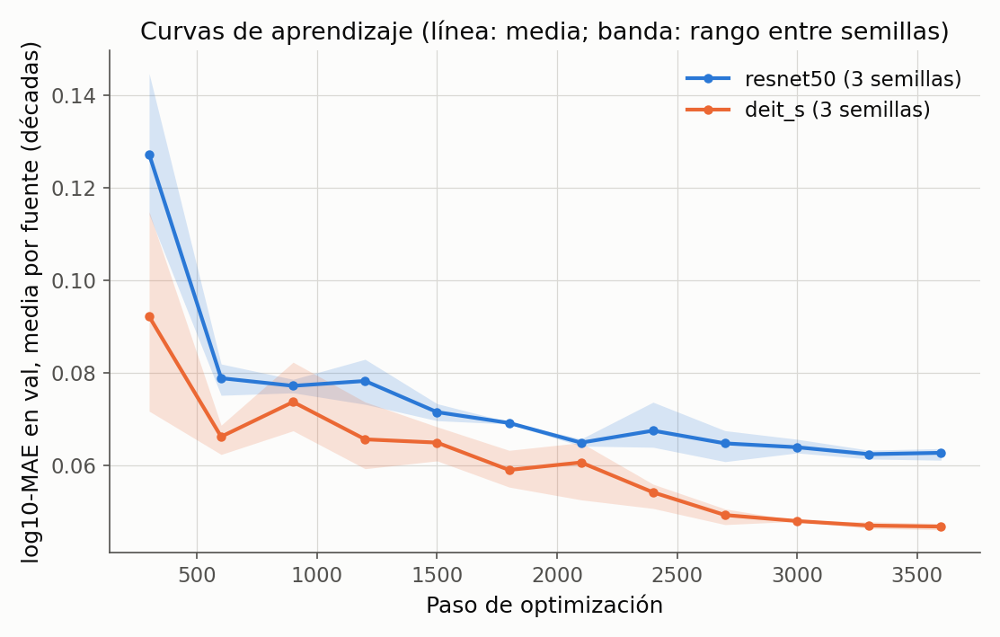

### Predicción vs. verdad (log-log) — externos

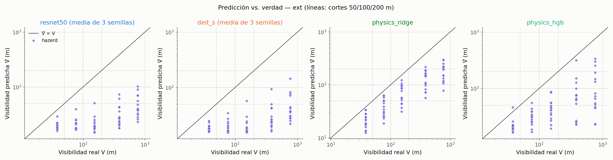

### Predicción vs. verdad (log-log) — test

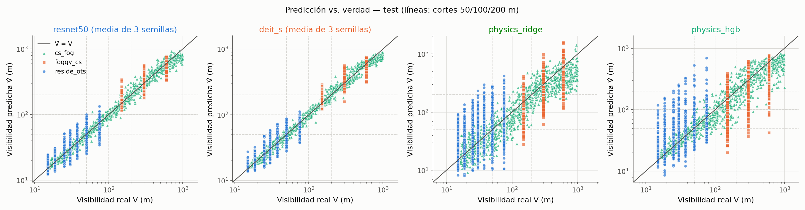

### Predicción vs. verdad (log-log) — validación

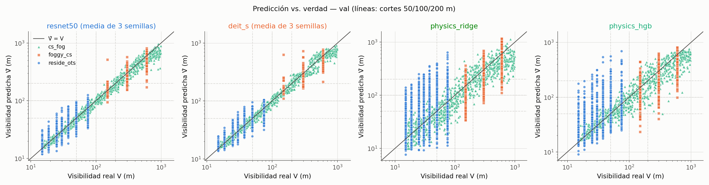

### Error absoluto por banda real — externos

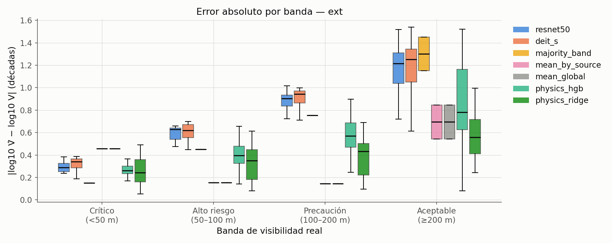

### Error absoluto por banda real — test

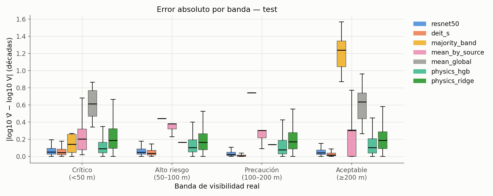

### Error absoluto por banda real — validación

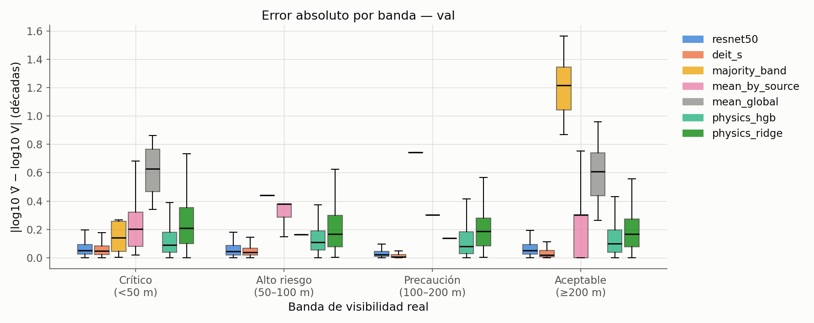

### Confusión de bandas — externos

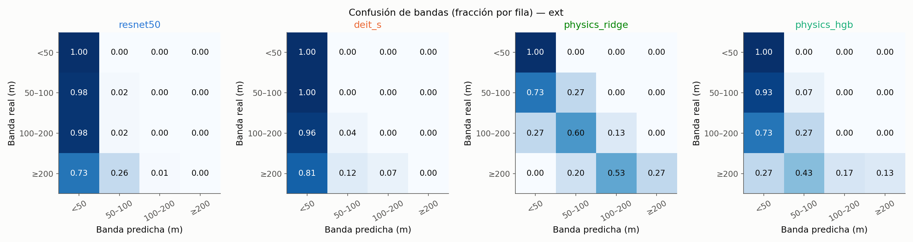

### Confusión de bandas — test

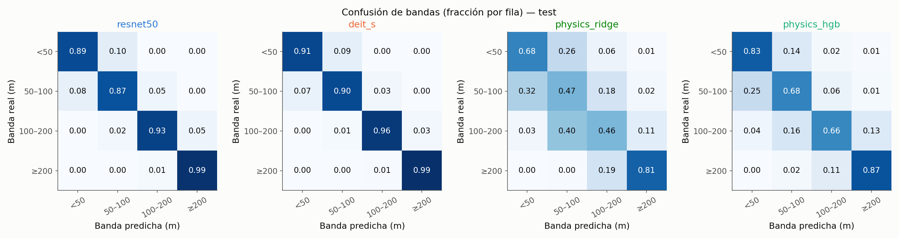

### Confusión de bandas — validación

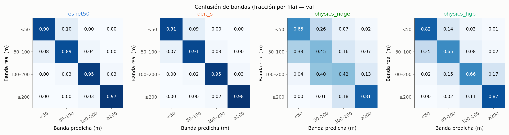

### Error por fuente con IC bootstrap — externos

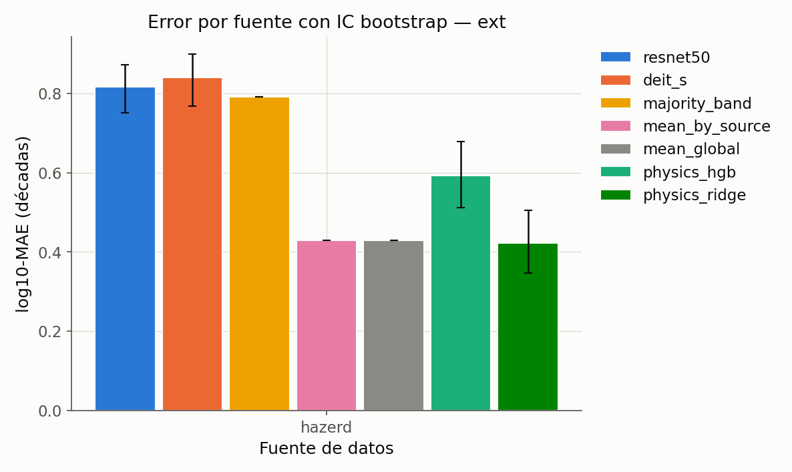

### Error por fuente con IC bootstrap — test

### Error por fuente con IC bootstrap — validación

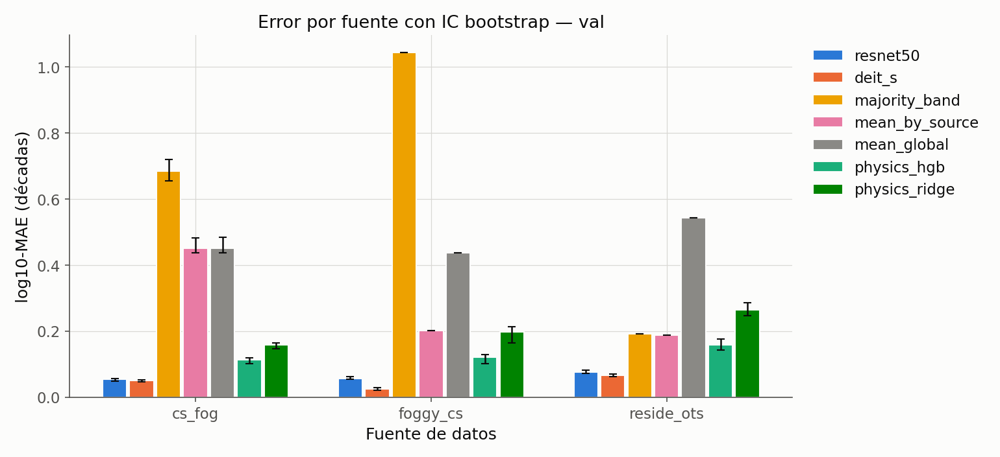

### Velocidad vs. precisión

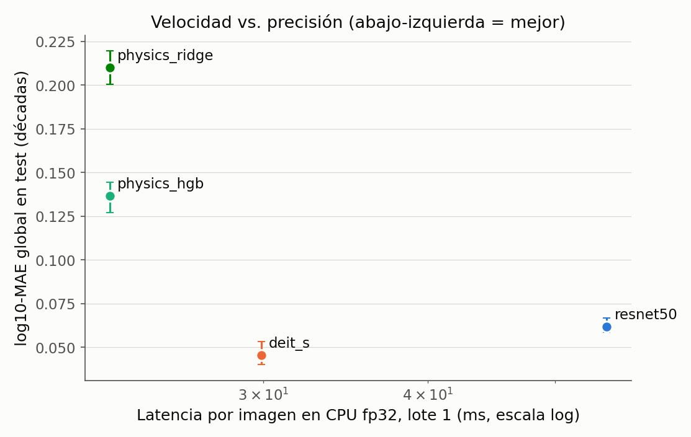

### interpret examples neg

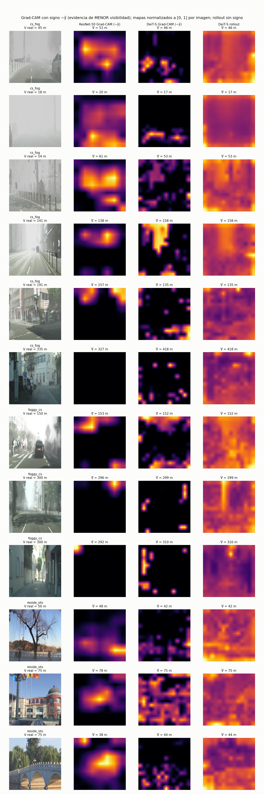

### interpret examples pos

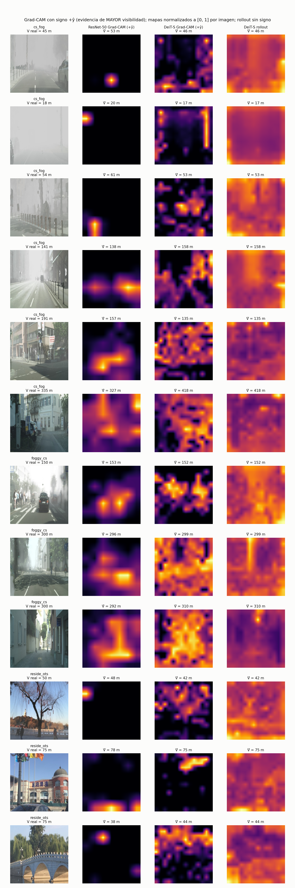
